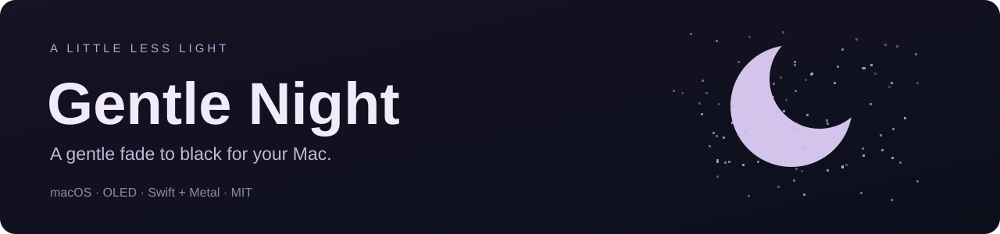
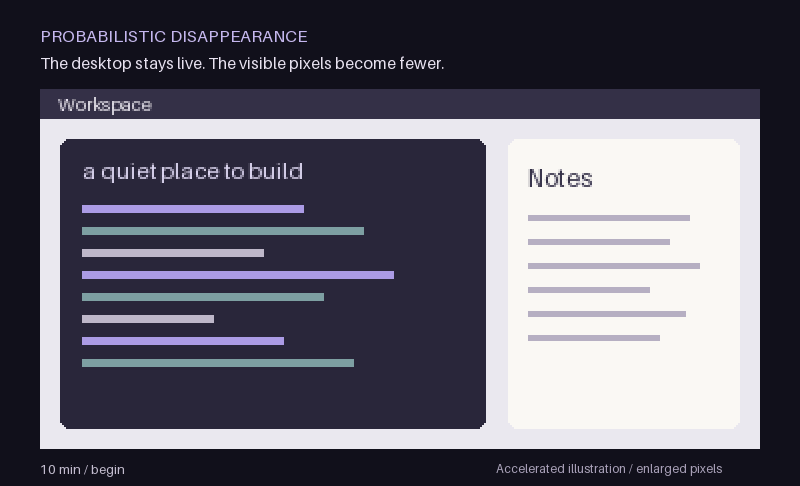
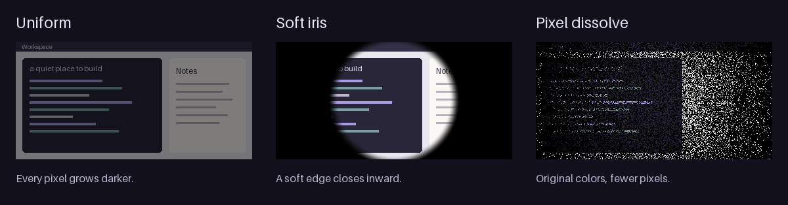

<p align="center">
  
</p>

<h1 align="center">Gentle Night</h1>
<p align="center"><strong>Let your display go dark. Keep your desktop running.</strong></p>

<p align="center">
  <a href="https://github.com/li1fang/gentle-night/actions/workflows/ci.yml"></a>
  <a href="LICENSE"></a>
  
  
</p>

<p align="center">
  <a href="#quick-start">Quick start</a> · <a href="#three-ways-to-fade">Effects</a> · <a href="docs/FAQ.md">FAQ</a> · <a href="docs/TESTING.md">Testing</a> · <a href="README.zh-CN.md">简体中文</a>
</p>

**Gentle Night is a free, open-source macOS menu-bar app that gradually fades an idle OLED display to black, then smoothly restores the current desktop when keyboard or mouse activity returns.** It uses a visual overlay: your session stays unlocked, the display stays connected, and your applications keep running.

Built for people using an OLED monitor or an OLED TV, such as an LG OLED, as their Mac display. The distinctive **pixel dissolve** keeps visible pixels at their original colors while progressively covering others with black.

> **Early native prototype · Build from source.** No prebuilt download, notarized installer, or Homebrew package is published yet. Real-device comfort and display compatibility are still being evaluated.

<p align="center"></p>

*Illustrated desktop, accelerated timing and enlarged pixels. This shows the visual model; it is not a screen recording or a measurement of OLED pixels. [Static preview](docs/assets/demo-poster.png).*

## Why Gentle Night?

- **A gradual transition.** Begin after 10 idle minutes and reach black at 60; both times are adjustable.
- **A quick, gentle return.** Recovery follows the same pattern in up to 0.8 seconds, shortened in proportion to fade progress.
- **Your live desktop underneath.** Transparent parts reveal current content; no frozen screenshot is needed.
- **Three visual choices.** Uniform dimming, a soft inward iris, or probabilistic pixel disappearance.
- **Small, local and native.** Swift, AppKit and Metal; no accounts, app network calls, analytics, or third-party runtime packages.
- **Control from the menu bar.** Preview, pause for an hour, change timing, restore immediately, or quit. Automatic fading starts disabled.

## Quick start

### 1. Build and open

You need **macOS 14+**, **Xcode 16+ with Swift 6**, and Git. Core Audio output-state detection requires macOS 14.2+. Python 3 is only needed for the test scripts.

```sh
git clone https://github.com/li1fang/gentle-night.git
cd gentle-night
bash scripts/build-app.sh
open "dist/Gentle Night.app"
```

The build script uses Xcode at `/Applications/Xcode.app` by default. If yours is elsewhere, set `DEVELOPER_DIR` to its `Contents/Developer` directory for the command. The build is local and ad-hoc signed; it is not notarized or installed into Applications automatically.

### 2. Try it before enabling it

1. Find **☾** in the menu bar. There is no Dock icon.
2. Select **Preview: 8 seconds (auto-restores)**. Stop moving the mouse to watch; activity reverses the preview early.
3. Try **Uniform**, **Soft iris**, and **Probabilistic disappearance**.
4. Use **Timing settings…** to adjust the start, black endpoint, and maximum recovery duration.
5. Turn on **Enable automatic fading** when ready.

The first click or key used to restore also reaches the application underneath. For an early trial, keep a disposable document in front rather than a sensitive button.

### 3. Know the defaults

| Setting | Default | Meaning |
| --- | --- | --- |
| Start fading | 10 idle minutes | Time since recognized activity |
| Reach black | 60 idle minutes | Total idle time, not another hour after the fade starts |
| Effect | Pixel dissolve | Called **Probabilistic disappearance** in the menu |
| Maximum recovery | 0.8 seconds | Halfway faded → about 0.4 seconds |
| Hold for audio | On | Active output streams hold the display visible; silent streams may count |
| Cursor hiding | Off | Experimental; the system pointer can remain visible |
| Automatic fading | Off at first launch | You choose when to enable it |

## Three ways to fade



| Effect | What changes |
| --- | --- |
| **Uniform** | All content becomes evenly darker. |
| **Soft iris** | A soft boundary closes inward toward the center. |
| **Pixel dissolve** | Pixels disappear earlier at the edges; a sparse central region remains, then disappears too. |

The dissolve uses a fixed threshold for each render pixel throughout one fade cycle. It does **not** roll new random noise every frame. Recovery reverses the same field while revealing the current desktop. See the [visual design and probability model](docs/DESIGN.md).

## What to expect today

| Topic | Current behavior |
| --- | --- |
| Locking and sleep | Does not lock the session or disconnect the display. Automatic mode temporarily prevents idle display/system sleep; quit releases it. |
| macOS screensaver | Global screensaver and password settings are unchanged. Configure automatic screensavers separately. |
| Audio | Reads output-stream status without recording audio. Silent video can still hold an output stream open. Unavailable metadata conservatively holds visibility when audio hold is on. |
| Permissions | Does not request Screen Recording, System Audio Recording, or Accessibility permission. |
| Displays | Targets the main display when the overlay is created; separate per-display profiles are not implemented. |
| Screenshots / OCR | Visual automation may capture the overlay. Compatibility must be checked with your own tools. |
| OLED pixels | Binary render pixels may be blended by display scaling. One-to-one panel mapping, HDR behavior and physical black level still need verification. |
| Protection | Designed to reduce visible static content during idle periods; no burn-in prevention, measured power saving or lifespan benefit is guaranteed. |

## Test an hour in seconds

Quit a running Gentle Night before rebuilding its app bundle.

```sh
# Core, CLI, build and packaging checks; suitable for CI
bash scripts/test.sh

# Add real GPU, audio-state and small-window checks on a logged-in Mac
bash scripts/test.sh --with-display

# Optional: also run a real full-display idle test
# 3s to start · 12s to black · automatic exit at 45s
bash scripts/test.sh --full-screen
```

The suite includes a virtual hour, nine Swift tests, 126 GPU renders and bounded window checks. Graphical tests are deliberately omitted in CI. Logs are written to `test-results/`. Read [testing and manual acceptance](docs/TESTING.md) and [recorded candidate validation](docs/VALIDATION.md) for the evidence and its limits.

## Questions people ask

- [Can I gradually black out my Mac without locking it?](docs/FAQ.md#can-i-gradually-black-out-my-mac-without-locking-it)
- [Does it work with an LG OLED TV used as a Mac monitor?](docs/FAQ.md#does-it-work-with-an-lg-oled-tv-used-as-a-mac-monitor)
- [Why does a silent video stop it from fading?](docs/FAQ.md#why-does-a-silent-video-stop-it-from-fading)
- [How do I remove it and restore normal sleep behavior?](docs/FAQ.md#how-do-i-remove-it-and-restore-normal-sleep-behavior)

## Help shape a quiet little utility

Useful contributions include reproducible display compatibility reports, clearer setup instructions, renderer improvements and accessibility feedback. Start with [contributing](CONTRIBUTING.md), [report a bug](https://github.com/li1fang/gentle-night/issues/new?template=bug_report.yml), or [suggest an improvement](https://github.com/li1fang/gentle-night/issues/new?template=feature_request.yml).

The next priorities are display scaling / HDR validation, cursor behavior, audio heuristics, and visual-automation compatibility. Blue-noise thresholds, per-display profiles and signed distribution are future work.

[MIT license](LICENSE) · [Security policy](SECURITY.md) · [Documentation index](docs/README.md)
