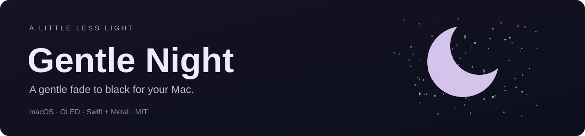
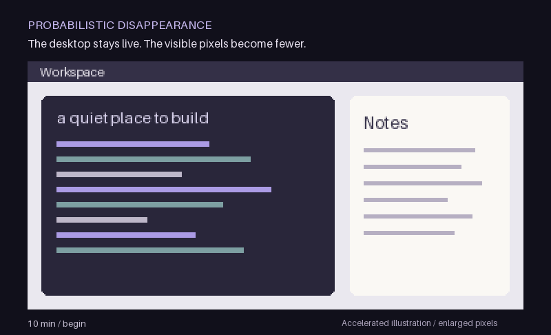
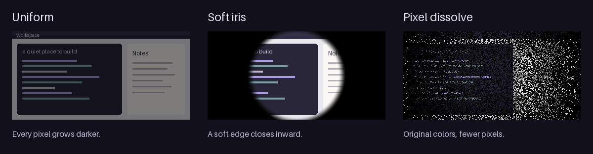

<p align="center"></p>

<h1 align="center">Gentle Night</h1>
<p align="center"><strong>让屏幕渐入夜色，让桌面继续运行。</strong></p>

<p align="center">
<a href="https://github.com/li1fang/gentle-night/actions/workflows/ci.yml"></a>
<a href="LICENSE"></a>

</p>

<p align="center"><a href="#快速开始">快速开始</a> · <a href="#三种渐黑方式">效果</a> · <a href="docs/FAQ.zh-CN.md">常见问题</a> · <a href="docs/TESTING.md">测试说明</a> · <a href="README.md">English</a></p>

**Gentle Night 是一款免费、开源的 macOS 菜单栏渐黑工具：在键鼠空闲时让 OLED 显示器逐渐变黑，活动后平滑恢复当前桌面。** 它使用视觉遮罩，不主动锁定会话或断开显示器，应用继续运行。

面向将 OLED 显示器或 LG OLED 电视用作 Mac 显示器的人。独特的**像素消隐**效果保留可见像素的原色，让外围先逐渐稀疏，最后连中央也归于黑暗。

> **早期原生原型，需要从源码构建。** 目前没有发布预编译下载、公证安装包或 Homebrew 包。实际观感与显示兼容性仍在验证中。

<p align="center"></p>

*使用示意桌面、加速时间和放大像素解释机制，并非录屏或 OLED 物理像素测量。[查看静态图](docs/assets/demo-poster.png)。*

## 为什么做 Gentle Night

- **慢慢暗下去。** 默认空闲 10 分钟开始、累计 60 分钟全黑，均可调节。
- **柔和地快速回来。** 沿原路径恢复，最长 0.8 秒；渐黑一半时约需 0.4 秒。
- **桌面保持实时。** 透明区域直接显示当前内容，不需要冻结截图。
- **三种效果可选。** 整屏渐暗、柔和收拢和概率像素消隐。
- **轻巧、原生、本地运行。** Swift、AppKit 和 Metal；应用没有账户、网络调用、分析统计或第三方运行时包。
- **菜单栏随时控制。** 预览、暂停一小时、修改时间、立即恢复和退出；首次启动时自动模式关闭。

## 快速开始

### 1. 构建并打开

需要 **macOS 14+**、**Xcode 16+ / Swift 6** 和 Git。音频输出状态检测需要 macOS 14.2+。只有运行测试脚本时才需要 Python 3。

```sh
git clone https://github.com/li1fang/gentle-night.git
cd gentle-night
bash scripts/build-app.sh
open "dist/Gentle Night.app"
```

脚本默认使用 `/Applications/Xcode.app`。如果 Xcode 位于其他位置，请为当前命令设置 `DEVELOPER_DIR`，指向其 `Contents/Developer` 目录。应用在本地构建并临时签名，尚未公证，不会自动安装到“应用程序”。

### 2. 先看预览，再开启自动模式

1. 找到菜单栏的 **☾**，应用没有 Dock 图标。
2. 点击 **Preview: 8 seconds (auto-restores)**。停止移动鼠标即可观看；键鼠活动会提前反向恢复。
3. 分别试试 **Uniform**、**Soft iris** 和 **Probabilistic disappearance**。
4. 在 **Timing settings…** 中设置开始时间、全黑时间和最长恢复时间。
5. 准备好后勾选 **Enable automatic fading**。

用于恢复的第一下点击或按键也会传给底层应用。初次尝试时，建议让可随意编辑的文档处于前台，避免盲点到重要按钮。

### 3. 默认设置

| 设置 | 默认值 | 含义 |
| --- | --- | --- |
| 开始渐黑 | 空闲 10 分钟 | 从认可的活动结束后计时 |
| 完全变黑 | 空闲 60 分钟 | 累计空闲时间，不是开始渐黑后再等一小时 |
| 效果 | 像素消隐 | 菜单中名为 **Probabilistic disappearance** |
| 最长恢复 | 0.8 秒 | 渐黑一半时约需 0.4 秒 |
| 音频保持 | 开启 | 输出流活跃时保持可见，静音流可能也被计入 |
| 隐藏鼠标 | 关闭 | 实验功能，系统指针可能继续可见 |
| 自动渐黑 | 首次启动关闭 | 由你决定何时开启 |

## 三种渐黑方式



| 效果 | 变化方式 |
| --- | --- |
| **整屏渐暗** | 所有内容均匀降低亮度。 |
| **柔和收拢** | 柔和边界从四周逐渐向中央收拢。 |
| **像素消隐** | 外围像素更早消失，中央变得稀疏，最后完全消失。 |

同一轮中每个渲染像素的阈值固定，不会每帧重抽随机数。恢复沿同一组阈值逆转，揭示的是当前桌面。[查看视觉设计与模型](docs/DESIGN.md)。

## 当前能力和边界

| 方面 | 当前行为 |
| --- | --- |
| 锁屏与休眠 | 不主动锁屏或断开显示器；开启自动模式会临时防止空闲显示器／系统休眠，退出时释放。 |
| 系统屏保 | 不修改系统屏保、密码设置；自动屏保需单独配置。 |
| 音频 | 不录音，只读取输出流状态。静音视频仍可能保持输出流活跃；状态不可用时，开启音频保持会保守地保持画面可见。 |
| 权限 | 不申请录屏、系统音频录制或辅助功能权限。 |
| 多显示器 | 遮罩建立时选择主显示器，尚无独立显示器配置。 |
| 截图和 OCR | 视觉自动化可能捕获遮罩，需要按工具验证。 |
| OLED 像素 | 显示缩放可能混合二值渲染像素；物理像素一一映射、HDR 和实际黑位仍待验证。 |
| 保护收益 | 目标是减少空闲时可见的静态内容，不保证防烧屏、实际节电或寿命收益。 |

## 用几秒验证一小时

重建应用前，请先退出正在运行的 Gentle Night。

```sh
# 核心、CLI、构建和打包检查，适用于 CI
bash scripts/test.sh

# 已登录的 Mac：增加真实 GPU、音频状态和局部窗口测试
bash scripts/test.sh --with-display

# 可选：增加真实全屏空闲测试
# 3 秒开始 · 12 秒全黑 · 45 秒自动退出
bash scripts/test.sh --full-screen
```

测试涵盖虚拟一小时、9 项 Swift 测试、126 次 GPU 渲染和有时限的窗口检查。CI 不运行图形测试；日志保存在 `test-results/`。详见[测试与手动验收](docs/TESTING.md)和[已记录的候选验证](docs/VALIDATION.md)。

## 常见问题与参与贡献

[渐黑时会锁屏吗？静音视频为何阻止渐黑？如何退出或移除？](docs/FAQ.zh-CN.md)

欢迎提交可复现的显示兼容性报告、改进使用说明或参与渲染和无障碍工作。先读[贡献指南](CONTRIBUTING.md)，再[报告问题](https://github.com/li1fang/gentle-night/issues/new?template=bug_report.yml)或[建议功能](https://github.com/li1fang/gentle-night/issues/new?template=feature_request.yml)。

下一步重点是显示缩放／HDR、光标、音频判断和视觉自动化兼容。蓝噪声、多显示器配置和正式签名分发属于后续工作。

[MIT 许可](LICENSE) · [安全策略](SECURITY.md) · [文档索引](docs/README.md)
